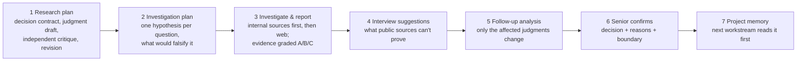
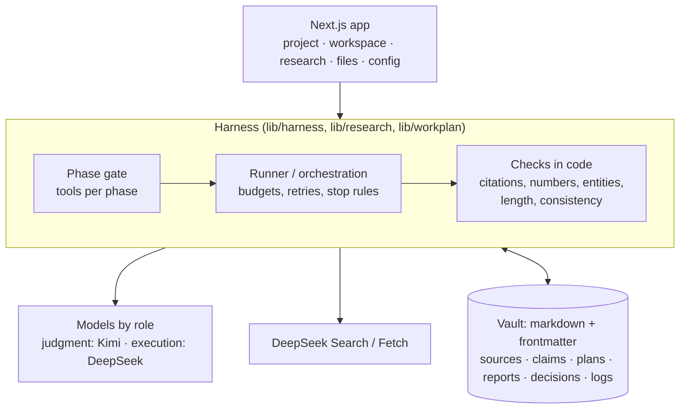

# Strategy Workbench

[](https://github.com/kumo-lin/strategy-workbench/actions/workflows/ci.yml) [](LICENSE)

**A research agent whose answers you can check.** A small strategy team and an LLM work through one decision together: frame the question, plan the research, gather and grade sources, write a report in which every footnote opens the sentence it rests on, and let a person confirm the decision, which the next piece of work then reuses.

Built on DeepSeek (`deepseek-flash` for execution, DeepSeek Search/Fetch for the web), with Kimi as a second, independent judge. Next.js + a markdown vault (Obsidian-compatible) as the team's memory.

[中文说明](README.zh-CN.md) · [Design decisions](docs/design-decisions.md) · [Model behaviour notes](docs/model-behavior.md) · [Evaluation](docs/evaluation.md) · [How it was built with coding agents](docs/building-with-coding-agents.md)

> **Try it without installing anything:** [**online demo**](https://kumo-lin.github.io/strategy-workbench/) (or open [`docs/demo/flow-simulation.html`](docs/demo/flow-simulation.html) locally). It replays the whole flow in the product's own UI without calling a model. [`docs/demo/walkthrough.html`](docs/demo/walkthrough.html) has the screenshots of every step.

---

## The problem

Ask a strong model a strategy question and you get a fluent answer. A team that has to *decide* on it runs into four things:

1. **You can't check it.** A cited link opens a page that says something else, or doesn't exist; numbers come without a source.
2. **It isn't stable.** Ask twice, get different reasoning, different sources and sometimes a different conclusion.
3. **Nothing accumulates.** What the team confirmed last month is not in the next conversation.
4. **Nobody owns the call.** The model's tone is the same for a fact, an inference and a guess.

The model is not the bottleneck. On the same DeepSeek model, the difference comes from the process around it: what it is allowed to do at each step, what it is shown, what code checks after it, and what a person has to confirm.

## What it does

A research run goes through seven steps; each has a person's checkpoint or a code-enforced rule.



- **Every footnote is checked three ways before it gets a ✓:** code checks that the numbers and names in the sentence appear in the quoted source; DeepSeek judges whether the quote supports the sentence; Kimi (thinking off) judges again, independently. All three must pass. Anything else is shown grey as "related, not verified". On 81 hand-labelled pairs, none of the 12 wrong citations got a ✓; with only 12, that bounds the true miss rate below ~25%, not at zero ([evaluation](docs/evaluation.md#citation-checks)).
- **The model only gets the tools of the current phase.** The phase is derived from vault state that only people can change (plan approved, report confirmed). No approved plan, no web access.
- **Judgments are computed, not written.** A hypothesis is "holds" only with two independent sources, at least one graded A or B; otherwise it is "evidence insufficient" and becomes a question for an expert. The summary and recommendation can only cite conditions that were judged; code renders the footnotes.
- **Memory is a vault of markdown notes.** Sources, claims (with block ids), plans, reports, decisions and logs, linked with wiki links. A confirmed decision is retrieved by the next investigation in the same project and shown as such.
- **Two models, two roles.** Judgment (planning, recommendations) and execution (search, extraction, self-check) are routed separately in config; switching a model is one line in `90_配置/模型.md`.

## Architecture



The vault stands in for the data and semantic layers a production system would put in a database; the trade-offs (concurrency, permissions, scale) are listed in [design decisions](docs/design-decisions.md#d-1-a-markdown-vault-instead-of-a-database).

## Run it

Requirements: Node 22 or newer, pnpm.

```bash
pnpm install
pnpm exec tsx scripts/demo-snapshot.ts make m1     # a demo vault in .scratch/m1
VAULT_DIR=.scratch/m1 MODEL_MOCK=1 WEB_TOOLS=mock MOCK_MODEL_DELAY_MS=600 pnpm exec next dev -p 3004
```

This runs the real engine (judgments, checks, storage) with a scripted model and scripted web pages, **no API key needed**. Open three windows, one per role: `http://senior.localhost:3004`, `http://junior-a.localhost:3004`, `http://junior-b.localhost:3004`.

With real models: `cp .env.example .env.local`, fill in `DEEPSEEK_API_KEY` and `MOONSHOT_API_KEY`, and start without `MODEL_MOCK` / `WEB_TOOLS`.

Checks: `pnpm typecheck && pnpm lint && pnpm test` (about 3,000 unit tests) and `pnpm test:e2e` (Playwright, mock models).

## What I learned (short version)

- **Rules the system can enforce should not live in the prompt.** Each layer that asks a model to rewrite the previous layer's free text loses information and adds an error. Freezing judgments and letting code assemble the summary and footnotes fixed a class of bugs that six rounds of prompt rules did not. ([D-51](docs/design-decisions.md#d-51-freeze-the-judgment-let-code-assemble-the-rest))
- **Measure what the structure buys, and what it costs.** Five rounds of the question-decomposition harness plateaued at 61–70 / 90. A blind A/B against a single call on the same model then showed the harness tied overall (5.17 vs 4.96 out of 7, within noise): better on in-domain questions, worse on unrelated ones because it forced every briefing note into the premises, at 5× the time and 63× the input tokens. I replaced it with a thinner loop: draft, independent critique, one revision. ([evaluation](docs/evaluation.md#decomposition-harness), [D-61](docs/design-decisions.md#d-61-a-thinner-harness))
- **"Quote matches the source" is not "the source is true."** One report cited a regulation that does not exist, taken from a user-uploaded document. Source reliability is now its own field, and upload platforms are graded C by default. ([D-29](docs/design-decisions.md#d-29-a-citation-to-a-document-that-does-not-exist))
- **The model is stricter than people think, and that is fine.** In the citation check both models accept only about a third of the pairs a person called "supported"; the safe end (0 wrong ✓) is what matters for a decision. ([evaluation](docs/evaluation.md#citation-checks))

## Limitations

- A full real-model run takes about 40 minutes (the investigation alone ~19 minutes, 13 searches and 31 page reads). For a simple question, asking a model directly is the right tool.
- The vault is single-machine and has no permissions model.
- Evaluation sets are small (5–8 questions, 3 runs each; 81 citation pairs) and judged by one person.
- The demo case (personal-AI strategy of a PC maker, using public information about Lenovo) contains **simulated** internal documents: meeting notes, business policy and interviews are made up for the demo.
- Reference notes keep only metadata and short quotes; full fetched pages are not redistributed.

## Repository map

| Path | What |
|---|---|
| `app/`, `components/` | Next.js pages and UI |
| `lib/harness/` | phases, tool registry, agent runner |
| `lib/research/` | investigation engine: plan, two-stage retrieval, evidence, judgment, self-check, citation checks |
| `lib/workplan/` | research-plan harness: decision contract, judgment draft, critique, revision, tree |
| `lib/vault/` | the markdown vault: read/write, links, blocks, citation checks |
| `demo-vault/` | vault config and demo snapshots (`.snapshots/`) |
| `evals/` | evaluation scripts and results |
| `tests/`, `e2e/` | unit tests and Playwright specs |
| `scripts/` | demo snapshots, evaluations, coding-agent scripts |

License: [MIT](LICENSE). Third-party code: see [THIRD_PARTY_NOTICES](THIRD_PARTY_NOTICES).
