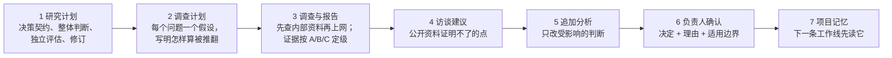
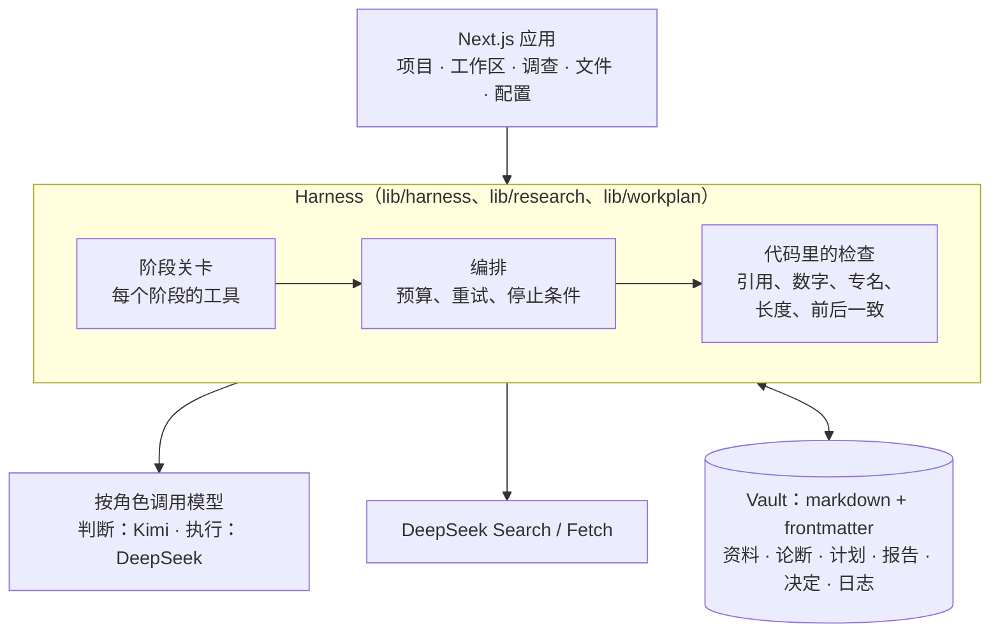

# 战略协作工作台

[](https://github.com/kumo-lin/strategy-workbench/actions/workflows/ci.yml) [](LICENSE)

**一个回答能被检查的研究型 Agent。** 2–3 人的战略小组和 AI 一起围绕一个决定工作：定义问题、规划研究、收集并给资料定级、写报告（每个脚注都能点开它所依据的原句），最后由人确认决定，下一项工作会自动用上这个决定。

模型用 DeepSeek（执行用 `deepseek-flash`，联网用 DeepSeek Search / Fetch），Kimi 作为第二个、独立的判断者。前端是 Next.js，团队的记忆是一个 markdown vault（可以直接用 Obsidian 打开）。

[English](README.md) · [设计决策](docs/design-decisions.md) · [模型行为观察](docs/model-behavior.md) · [评测](docs/evaluation.md) · [怎么用编程 Agent 做这个项目](docs/building-with-coding-agents.md)

> **不用安装就能看：**[**在线演示**](https://kumo-lin.github.io/strategy-workbench/)（或者在本地用浏览器打开 [`docs/demo/flow-simulation.html`](docs/demo/flow-simulation.html)）。它在产品自己的界面里把整个流程走一遍，不调用模型。每一步的截图在 [`docs/demo/walkthrough.html`](docs/demo/walkthrough.html)。

---

## 要解决的问题

拿一个战略问题去问强模型，会得到一个流畅的回答。但一个要**据此做决定**的团队会碰到四件事：

1. **没法检查。**链接点开说的是另一件事，或者根本打不开；数字没有出处。
2. **不稳定。**问两次，推理不同、来源不同，有时结论也不同。
3. **不积累。**团队上个月确认过的事，下一次对话里没有。
4. **没人对结论负责。**事实、推断和猜测，模型用的是同一种语气。

瓶颈不在模型。用同一个 DeepSeek 模型，差别来自模型外面的流程：每一步允许它做什么、给它看什么、它做完以后代码查什么、哪些事必须由人确认。

## 它怎么工作

一次研究走七步，每一步都有人的确认点或由代码执行的规则：



- **脚注过三道关才挂 ✓：**代码核对句子里的数字和专有名词在引文里出现；DeepSeek 判引文撑不撑得住这句话；Kimi（关掉思考）再独立判一次。三道都过才挂 ✓，其余显示灰色"相关资料（未核实）"。81 对人工标注样本里，12 个挂错的引用没有一个拿到 ✓。不过 12 个样本只能把真实错挂率的上限压到约 25%，不能说是零（[评测](docs/evaluation.md#citation-checks)）。
- **每个阶段，模型只拿到这个阶段的工具。**阶段由 vault 的状态推出，而这些状态只有人能改（计划批准、报告确认）。计划没批准，就拿不到联网工具。
- **判断由规则算出，不由模型写出。**一个假设要判"成立"，需要两条互相独立的来源，其中至少一条是 A 或 B 级；否则就是"证据不足"，并转成要问专家的问题。Summary 和推荐只能引用已经判过的条件，脚注由代码渲染。
- **记忆是一个 markdown vault。**资料、论断（带块编号）、计划、报告、决定和日志用双链连起来。确认过的决定会被同一个项目里的下一次调查检索到，并标明"已确认的决定"。
- **两个模型，两种角色。**判断（规划、推荐）和执行（检索、抽证据、自检）在配置里分开路由；换模型只改 `90_配置/模型.md` 里的一行。

## 架构



vault 代替了正式系统里放在数据库里的数据层和语义层；少了什么（并发、权限、规模）写在[设计决策](docs/design-decisions.md#d-1-a-markdown-vault-instead-of-a-database)里。

## 跑起来

需要 Node 22 或更新的版本，以及 pnpm。

```bash
pnpm install
pnpm exec tsx scripts/demo-snapshot.ts make m1     # 生成演示 vault：.scratch/m1
VAULT_DIR=.scratch/m1 MODEL_MOCK=1 WEB_TOOLS=mock MOCK_MODEL_DELAY_MS=600 pnpm exec next dev -p 3004
```

这样跑的是真实的引擎（判断、检查、存储），模型和网页用脚本替身，**不需要 API key**。开三个窗口，每个角色一个：`http://senior.localhost:3004`、`http://junior-a.localhost:3004`、`http://junior-b.localhost:3004`。

用真实模型：`cp .env.example .env.local`，填上 `DEEPSEEK_API_KEY` 和 `MOONSHOT_API_KEY`，启动时去掉 `MODEL_MOCK` 和 `WEB_TOOLS`。

检查：`pnpm typecheck && pnpm lint && pnpm test`（约 3,000 条单元测试），`pnpm test:e2e`（Playwright，模型用替身）。

## 学到的几件事

- **系统能保证的规则，不该写在提示词里。**每让模型重写一遍上一层的自由文本，就丢一次信息、多一次错。把判断冻结、让代码拼装 Summary 和脚注，解决了六轮提示词规则都没解决的一类问题。（[D-51](docs/design-decisions.md#d-51-freeze-the-judgment-let-code-assemble-the-rest)）
- **量一下结构换来了什么、花了多少。**拆题的 harness 连续五轮评测停在 61–70 / 90。之后和"同一个模型直接写一次"做了 A/B 盲评：总分打平（5.17 对 4.96，满分 7，在误差以内）；本领域的题上 harness 更好，无关的题上更差（它把资料包里的每条指示都硬塞进前提），而代价是 5 倍的时间和 63 倍的输入 token。于是换成更薄的循环：草案、独立评估、修订一次。（[评测](docs/evaluation.md#decomposition-harness)、[D-61](docs/design-decisions.md#d-61-a-thinner-harness)）
- **"引文对得上原文"不等于"原文是真的"。**有一份报告引用了一份不存在的监管文件，来源是用户上传到文库平台的文档。现在来源可靠性是单独的字段，上传类平台默认 C 级。（[D-29](docs/design-decisions.md#d-29-a-citation-to-a-document-that-does-not-exist)）
- **模型比人以为的更严，这没关系。**在引用核对上，两个模型都只认人判"撑得住"的约三分之一；对决定来说，重要的是安全的那一头：挂错的不能拿到 ✓。（[评测](docs/evaluation.md#citation-checks)）

## 局限

- 用真实模型完整跑一遍约 40 分钟（其中调查约 19 分钟，联网搜索 13 次、读网页 31 次）。简单的问题，直接问模型才是对的工具。
- vault 只在单机上，没有权限模型。
- 评测样本小（5–8 道题、每题 3 次；81 对引用），判分大多是一个人。
- 演示案例是"一家 PC 厂商的个人 AI 战略"，用的是联想的公开信息；案例里的内部资料（会议纪要、业务方针、访谈）都是**为演示虚构的**。
- 资料库只保留元数据和简短的原文摘句，不转载抓取到的网页全文。

## 目录

| 路径 | 内容 |
|---|---|
| `app/`、`components/` | Next.js 页面和界面 |
| `lib/harness/` | 阶段、工具注册、Agent 运行 |
| `lib/research/` | 调查引擎：计划、两段检索、证据、判断、自检、引用核对 |
| `lib/workplan/` | 研究计划的 harness：决策契约、整体判断、评估、修订、问题树 |
| `lib/vault/` | markdown vault：读写、链接、块、引用核对 |
| `demo-vault/` | vault 配置和演示快照（`.snapshots/`） |
| `evals/` | 评测脚本和结果 |
| `tests/`、`e2e/` | 单元测试和 Playwright 用例 |
| `scripts/` | 演示快照、评测、编程 Agent 脚本 |

许可证：[MIT](LICENSE)。第三方代码见 [THIRD_PARTY_NOTICES](THIRD_PARTY_NOTICES)。
